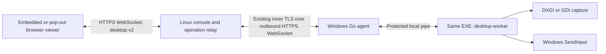

# Go remote desktop: architecture and implementation handoff

**Status: design only, 2026-10-30.** The current release still uses the bundled MeshAgent desktop engine. This document specifies its replacement; it does not describe functionality already shipped. Implement in the stages below and keep PowerShell, files, authentication, and installation working throughout.

## 1. Decisions and scope

- Build the desktop engine into the existing Go Windows EXE. Launch that same EXE as a short-lived `desktop-worker` child for an authorized desktop session. No separate runtime or capture driver.
- Use Windows capture and input APIs through small Go bindings. Start with GDI capture to establish a working end-to-end baseline; then make DXGI Desktop Duplication the preferred backend with a deliberate GDI fallback.
- Initially transmit full JPEG frames over the existing agent tunnel and browser WebSocket. Introduce changed regions or video encoding only after correctness and resource measurements justify them.
- Keep the existing Linux server, passkeys, device certificates, operation tickets, inner TLS, and outbound connection topology. No new exposed Windows listener, STUN/TURN deployment, or cryptographic protocol.
- One controlling viewer per device, including across browser tabs and different admins. Support monitor selection, fit-to-window/actual size, view-only mode, a dedicated pop-out viewer, and fullscreen.
- Preserve the three installation modes: per-user persistence without elevation by default; explicit elevated service installation; temporary execution with its existing end-session behavior.
- Public default installs require only an authenticated admin's **Approve device** click. No local pairing code or local approval prompt. Private one-device invitations retain their existing semantics.
- Original code remains CC0. Retain upstream notices for any adapted code. References below do not become dependencies merely by being listed.

The first Windows target is an ordinary interactive desktop on Windows 10/11, x64. Keep ARM64 builds compiling and validate their Win32 structure layouts separately. Service sessions, RDP sessions, elevated windows, lock/unlock, and display changes are explicit milestones, not assumptions inferred from a successful build. Audio, clipboard synchronization, file drag-and-drop, simultaneous viewers, recording, HDR fidelity, headless virtual monitors, and a login-screen/SAS implementation are outside the first replacement release.

## 2. Reference projects

Reference snapshots inspected on 2026-10-30. Use the pinned revision when adapting code and record the exact files and notices in `THIRD_PARTY_NOTICES.md`. Existing runtime dependencies remain pinned by `go.mod`; this table is not an instruction to upgrade them.

| Project / pinned snapshot | License | How to use it |
| --- | --- | --- |
| [Microsoft Desktop Duplication sample](https://github.com/microsoft/Windows-classic-samples/tree/434f6002bdf9cf9829406c3ff2b33387982d6168/Samples/DXGIDesktopDuplication) | [MIT](https://github.com/microsoft/Windows-classic-samples/blob/434f6002bdf9cf9829406c3ff2b33387982d6168/LICENSE); check individual copied files | Main reference for DXGI frame acquisition, resource lifetime, display rotation, cursor composition, and recovery. C++ reference, not a component to ship. |
| [kbinani/screenshot](https://github.com/kbinani/screenshot/tree/089614a940181bba6e846e21ff436ea652a5b374) | [MIT](https://github.com/kbinani/screenshot/blob/089614a940181bba6e846e21ff436ea652a5b374/LICENSE) | Go GDI capture and monitor-coordinate reference. Adapt the small Windows-specific portion if useful; keep our capture interface and error reporting. |
| [shinkar94/godesktopdup](https://github.com/shinkar94/godesktopdup/tree/1102d7f388548efd665357d6ce30a8daaa73afa6) | [MIT](https://github.com/shinkar94/godesktopdup/blob/1102d7f388548efd665357d6ce30a8daaa73afa6/LICENSE) | Go DXGI/D3D11 binding and BGRA readback reference. Audit COM calls, resource cleanup, and architecture assumptions before reuse; this is not a complete support engine. |
| [golang.org/x/sys/windows](https://github.com/golang/sys/tree/4a36a34831dc532df9d415f97ba515cb88635ff2/windows) | [BSD-3-Clause](https://github.com/golang/sys/blob/4a36a34831dc532df9d415f97ba515cb88635ff2/LICENSE) | Existing dependency for handles, tokens, process/session APIs. Add only missing declarations locally, using Windows definitions and explicit layouts. |
| [Microsoft/go-winio](https://github.com/microsoft/go-winio/tree/62629cf958d03fbc744fd4b6ca1ae6a19f5a79dc) | [MIT](https://github.com/microsoft/go-winio/blob/62629cf958d03fbc744fd4b6ca1ae6a19f5a79dc/LICENSE) | Existing named-pipe implementation. Reuse the current ACL and peer-PID checks for worker IPC. |
| [coder/websocket](https://github.com/coder/websocket/tree/bd31a8f17dc7091633f9215bdafa6bc02025e82d) | [ISC](https://github.com/coder/websocket/blob/bd31a8f17dc7091633f9215bdafa6bc02025e82d/LICENSE.txt) | Existing browser and outer tunnel transport. Preserve bounded messages, cancellation, exact-origin checks, and disabled compression for JPEG. |
| [Pion WebRTC](https://github.com/pion/webrtc/tree/0e35f8059c5a7cb2002b53f8b2017f8148ee2fc7) | [MIT](https://github.com/pion/webrtc/blob/0e35f8059c5a7cb2002b53f8b2017f8148ee2fc7/LICENSE) | Future transport reference only. It does not provide Windows capture or a video encoder. Do not add it to the initial implementation. |

The Microsoft repository also contains some separately licensed assets. Check the selected source files; do not import the repository wholesale. No copyleft code is selected for reuse. A Go port of upstream source must retain that source's license notice.

## 3. Components and boundaries

The Windows agent initiates both control and operation connections. Double NAT requires no inbound agent ports. This design keeps the existing inner authenticated TLS connection through an outer HTTPS connection that may be inspected. It still depends on the network allowing the outer WebSocket upgrade and traffic; do not silently replace TLS verification or authentication when a proxy rejects it. The server terminates the inner tunnel and relays frames to the authenticated browser; this is not browser-to-device encryption that excludes the server.

### Existing code to preserve

| Location | Responsibility in the new implementation |
| --- | --- |
| `internal/tunnel/`, `internal/identity/`, `internal/agent/` | Outbound transport, enrollment, device keys, cancellation on control disconnect. |
| `internal/state/`, `internal/console/console.go` | Pending/approved/revoked state, passkeys, CSRF, current admin/session checks. |
| `internal/management/operations.go` | Single-use operation tickets bound to device and exact control connection; deadlines and audit attribution. |
| `internal/operations/operations.go`, `internal/wire/operations.go` | Validate and dispatch the new desktop operation without changing shell/file framing. |
| `internal/winproc/process_windows.go` | Suspended child creation, Job Object assignment before execution, kill-on-close cleanup. |
| `internal/winagent/desktop_windows.go` | Replace the native engine adapter with worker startup and session selection. |
| `internal/console/desktop.go` | Replace the Mesh packet parser for the new route with the bounded v2 relay. |
| `internal/console/web/support.js` | Connect shared viewer component to the existing agent detail page. |

### Proposed new code

- `internal/desktop/protocol.go`: portable envelope codec, message validators, limits; no Windows dependencies.
- `internal/desktop/session.go`: generation, ACK/backpressure, deadlines, lifecycle; injectable capture/input interfaces for local tests.
- `internal/desktop/capture_windows.go`, `gdi_windows.go`, `dxgi_windows.go`: monitor discovery, capture backends, Windows resource management.
- `internal/desktop/input_windows.go`: bounded event types, key-state tracking, coordinate transforms, `SendInput`.
- `internal/desktop/worker_windows.go`: local IPC loop, capture/input ownership, no server connection or enrollment code.
- `internal/winagent/desktop_windows.go`: authenticated operation adapter and worker supervisor; keep Windows identity logic here or in a focused session helper.
- `internal/console/web/desktop-viewer.js`: reusable viewer class with explicit `connect`, `disconnect`, `releaseInput`, and `destroy`.
- `internal/console/web/desktop.html` / `desktop-page.js`: dedicated viewer shell using existing theme tokens.

Use `golang.org/x/sys/windows` and Go standard image packages. Avoid a new cgo toolchain for the baseline. Keep unsafe COM/Win32 bindings isolated from protocol and application logic. Check `INPUT`, unions, pointer-sized fields, alignment, calling conventions, HRESULTs, and allocation arithmetic on both architectures.

## 4. Windows process, session, and privilege model

The network agent owns configuration and device credentials. It starts a worker only for an approved desktop operation. The worker receives a local pipe name and parent identity, then session settings through that pipe. It has no reconnect loop, enrollment credential arguments, network listener, or independent persistence.

| Agent mode | Worker session and token | Initial behavior |
| --- | --- | --- |
| Default per-user | Same interactive Windows session and token as agent | Capture and input on the user's ordinary desktop. No elevation prompt. |
| Explicit elevated interactive run | Same session and elevated token | Ordinary desktop capture/input with that token's privileges. |
| Service | Explicit selected interactive WTS session; launch with its logged-on user token | Default to active console when available. If multiple active sessions exist, require operator selection. No capture in session 0. |
| Temporary | Same interactive session/token as running EXE | Worker stops with desktop operation; whole agent still follows existing temporary disconnect behavior. |

Microsoft documents [service isolation in session 0](https://learn.microsoft.com/en-us/windows/win32/services/interactive-services) and [WTSQueryUserToken](https://learn.microsoft.com/en-us/windows/win32/api/wtsapi32/nf-wtsapi32-wtsqueryusertoken) for obtaining a logged-on user's primary token from a LocalSystem service. Use documented token/environment handling, close token handles, and launch into `winsta0\default`. Extend `winproc.StartAsUser` to pass the appropriate environment if required; never inherit handles across sessions.

For service-mode elevated control, add an explicit console control and a separately tested worker-launch policy in stage 6. The service may launch the same bounded worker with its service token assigned to the selected session; keep the desktop restricted to the ordinary interactive desktop for this release. This is a distinct operation, requires fresh admin authentication, is audited with session and privilege, and must be requested through the authenticated operation, never through a worker-supplied launch argument. Do not automatically elevate the default per-user mode. UAC secure desktop, login-screen capture, and Secure Attention Sequence are separate later work. A service remains reachable for PowerShell/files before anyone logs on; the viewer displays `no_interactive_session` then.

[SendInput is subject to UIPI](https://learn.microsoft.com/en-us/windows/win32/api/winuser/nf-winuser-sendinput): a standard worker cannot drive higher-integrity windows. Report failed input and actual worker privilege; a zero return alone does not prove UIPI caused it. Never implement automatic elevation, a UIAccess workaround, or desktop ACL changes to make an input call appear successful.

### IPC and cleanup

1. Parent creates an unpredictable local named pipe with an explicit DACL for its identity, SYSTEM, and the selected worker identity as needed. Reject remote clients; if the library does not expose the required pipe flag, supply a small reviewed wrapper. Create the listener before spawning.
2. Start the installed, verified agent EXE by absolute path. In service mode it must reside in the existing protected installation directory. Keep the process suspended until assigned to a kill-on-close Job Object.
3. Parent verifies `GetNamedPipeClientProcessId` equals the live child PID. Child verifies the named-pipe server PID matches its expected live parent. Use a protocol handshake and a 10-second startup deadline. Random names alone are not peer authentication.
4. Send settings only after peer verification. Worker command line never contains an invitation, certificate key, session cookie, or operation ticket. Disallow worker requests to execute commands, access arbitrary files, or spawn other processes.
5. One goroutine owns each stream writer. Use bounded IPC frames and apply the same message validation as the remote protocol. Treat the worker's input as untrusted at the service parent.
6. Cancellation closes the pipe/stream, requests a short graceful input release, then kills and waits for the worker/job. Do not leave capture threads or children detached. Worker crash, parent exit, device revocation, admin revocation/logout, control reconnect, operation timeout, and session change all close the operation.

Process separation provides crash containment and bounds the service-facing IPC; a same-user child is not a confidentiality boundary against other code already running as that user.

## 5. Capture, pixels, and recovery

### Shared capture contract

Each backend exposes monitor enumeration, frame acquisition with a deadline, and close. Return an owned immutable frame or a documented lease whose lifetime ends before the backend reuses its storage. Supply physical desktop bounds, a geometry generation, capture timestamp, backend name, and structured errors. Protocol code must not contain COM pointers or OS handles.

Establish per-monitor DPI awareness before querying coordinates or creating capture resources. Keep relevant Win32/COM calls on an OS thread using `runtime.LockOSThread`; initialize/uninitialize COM on that thread where needed. Keep input-thread desktop association consistent with the capture session. Bind to the ordinary desktop at worker startup; on a desktop/session change, release state and restart or pause through the supervisor instead of opportunistically switching a busy thread.

### GDI baseline

Follow the [Microsoft GDI capture example](https://learn.microsoft.com/en-us/windows/win32/gdi/capturing-an-image) and the Windows implementation of the screenshot reference. Use a screen DC, compatible memory DC, top-down 32-bit DIB section, and `BitBlt` with the selected monitor's physical origin. A [DIB section](https://learn.microsoft.com/en-us/windows/win32/api/wingdi/nf-wingdi-createdibsection) avoids the selected-bitmap pitfalls of `GetDIBits`; call `GdiFlush` before reading its pixel storage. Check every handle and result. Restore the previous selected object before deleting a bitmap/DC; release screen DCs correctly. Convert BGRA to the encoder's expected RGB layout, including stride and top-down orientation. Compose the visible cursor once using its actual hotspot.

### DXGI backend

Follow Microsoft's [Desktop Duplication API](https://learn.microsoft.com/en-us/windows/win32/direct3ddxgi/desktop-dup-api) for frame lifetime and metadata. Enumerate outputs by adapter, create the D3D11 device for the chosen adapter/output, duplicate the output, and copy acquired textures into reusable CPU-readable staging textures. Respect `RowPitch`; never assume tightly packed pixels. Release each acquired frame exactly once, including error paths, and unmap before reuse. Initially use complete frames; add dirty/move processing later. Handle rotation and whether the cursor is already present before composition.

- Acquisition timeout means no new frame, not failed capture.
- Access lost or device removed/reset invalidates resources. Pause input, advance geometry generation, rebuild with bounded retry/backoff, and send a complete new frame.
- GDI fallback is allowed when DXGI is unavailable or unsupported on an ordinary desktop. Record the reason and active backend. Access denied, locked session, and secure desktop are explicit statuses; do not repeatedly switch APIs against those states.
- Changing monitors, display hotplug, DPI changes, RDP reconnect, or session lock invalidates coordinate mappings. Suspend input until the new geometry/frame is acknowledged.
- Handle negative monitor origins and rotations explicitly. Start with one selected monitor; do not create a giant virtual-desktop framebuffer just to send one display.
- Define SDR output for the first release. Report unsupported display formats/HDR cases when conversion has not been implemented and verified. No fake display driver for a headless computer.

A valid all-black frame is still valid. Detect capture failure from API outcomes and pipeline progress, not from pixel color. An idle desktop also remains valid without changing pixels.

### Resource and quality bounds

Initial defaults: JPEG quality 70, maximum output edge 1920 pixels, up to 10 FPS, approximately 8 Mbit/s desktop egress target per operation. Settings may select quality 40–85, 1–15 FPS, and a maximum edge up to 2560. These are targets for tuning, not measured performance claims. Lower FPS/quality/size under sustained congestion; let the operator favor text readability.

Bound source monitor dimensions to 16,384 on either axis and 16,777,216 total pixels; larger sources return `unsupported_geometry` until a bounded downsampling path exists. Check products in 64-bit arithmetic before allocation. Output frames are bounded to 2560 on either axis and the same pixel cap. Budget owned raster buffers explicitly (maximum two 64 MiB buffers); JPEG output is capped at 8 MiB including metadata using a limited writer. Do not let `bytes.Buffer` grow first and check afterwards. Reuse capture/encode buffers and release GPU/GDI resources on every exit.

Keep at most one unacknowledged encoded frame and one latest pending capture. While awaiting ACK, coalesce/drop capture work instead of queueing historical frames. A slow viewer may receive fewer frames; it must not cause unbounded memory or delayed input. Flush small input/status messages promptly. Separate input reading from image encoding, while preserving one ordered writer per direction.

## 6. Wire protocol and compatibility

### Upgrade path

Keep existing control `wire.Version = 1`, `Hello`, and shell/file fields unchanged for the initial replacement. Their decoder rejects unknown fields, so adding optional fields still breaks old peers.

Add an operation kind `desktop-v2` using the **existing** `wire.Operation` shape. Update its validator, handler dispatch, and desktop-exclusivity checks. Both `desktop` and `desktop-v2` must share the same per-device desktop lock and count against existing global/per-device limits. A legacy agent will reject `desktop-v2` and close its operation stream; display a clear desktop upgrade-required result while keeping that agent's shell/files usable. Do not automatically retry through the old Mesh engine. New agents and new server code use the new route `/api/devices/{id}/desktop-v2` and subprotocol `zireael-desktop-v2`.

Deploy server first, then new agents. Do not infer feature support solely from OS or architecture. For a later persistent capability inventory, introduce a separately negotiated control version rather than silently extending strict v1 structures. Upgrades must preserve existing configuration, identity, persistence mode, and installation paths. The present installer is not an updater: implement and verify an identity-preserving upgrade path before claiming existing agents can be upgraded in place.

### Opening an operation

1. Authenticate the browser and exact Origin/subprotocol before creating an operation. Reuse `operationContext` so browser authorization is checked during the session.
2. Create a device-bound single-use ticket through `OperationAs`; send `desktop-v2` over the authenticated operation stream.
3. Agent validates and reserves a desktop slot. It writes existing `wire.Result{Type:"ready"}` solely to mark **protocol acceptance**, then switches exclusively to v2 framing.
4. Server validates that reply, accepts the browser WebSocket, and starts relaying v2 envelopes. The UI remains “Starting capture.” Worker/session selection happens using the v2 controls below.
5. Stream structured status/geometry and a first valid JPEG. Only after the browser decodes, draws, and acknowledges that frame does the UI say “Connected.” A ready reply, child PID, or open pipe is not a working desktop.

Before the ready reply, errors use existing `wire.Result`. After it, errors must use v2 status envelopes or close the stream. Modify `operations.Handler` accordingly: it must not append a v1 JSON error to an already-started v2 stream.

### Envelope

Use one complete binary envelope per browser WebSocket message. The same format is length-framed on the agent TLS stream and local pipe. All integer fields are unsigned big-endian unless specified.

| Bytes | Field |
| --- | --- |
| 0–3 | ASCII `ZRD2` (protocol magic and version) |
| 4 | Type: `1` JSON control, `2` JPEG frame |
| 5 | Flags, must be zero |
| 6–7 | Reserved, must be zero |
| 8–11 | Payload length, excludes the 12-byte envelope |
| 12 onward | Exactly that many payload bytes |

A JSON control payload is 1 byte through 16 KiB, UTF-8, one object with a required `type`, no trailing value, and no unrecognized fields for that type. A JPEG payload is 25 bytes through 8 MiB: 24 bytes of metadata followed by a nonempty JPEG. Reject bad magic/flags/type/length/direction before allocation. The server and worker independently enforce controls, rates, and geometry rules; a browser check is not authorization.

JPEG metadata: six `uint32` fields: `sequence`, `generation`, `monitorID`, `width`, `height`, `reserved` (zero). The remainder is the JPEG. Width/height are encoded raster dimensions. Sequence starts at 1 and strictly increases within the operation; generation starts at 1 and advances on geometry/session resets. Validate the JPEG header dimensions with a bounded header reader (`jpeg.DecodeConfig` in Go) against metadata and pixel limits before browser decode. Server relays JPEG bytes without transcoding. It may read the bounded complete packet to validate it; budget that memory against the existing maximum concurrent operations.

### Control messages

Freeze concrete Go/JavaScript schemas and golden fixtures in stage 1. The following fields and directions define the initial contract. String values have explicit byte limits; IDs are integer selectors scoped to this operation, never OS handles supplied by the browser.

| Direction | Message and fields | Rules |
| --- | --- | --- |
| Agent → viewer | `hello {protocol:2, sessions:[{id,label,active}], defaultSession, elevatedAvailable}` | Max 16 sessions, labels 128 UTF-8 bytes. Includes only sessions the agent may actually access. Null default if operator choice required. |
| Viewer → agent | `start {sessionID, privilege, viewOnly, maxFPS, maxEdge, quality}` | One start per worker lifecycle; privilege `user` or explicit `elevated`. Validate session against enumeration and recheck immediately before spawning. Elevated requires service policy/fresh console authorization. The console relay checks its bound browser session timestamp and current admin record at receipt, before forwarding; a worker cannot assert freshness. |
| Agent → viewer | `status {state,code,message,backend,elevated}` | Enumerated states/codes; message <=256 bytes and rendered as text. States: starting, streaming, paused, error, closing. |
| Agent → viewer | `geometry {generation, monitors:[{id,label,x,y,width,height,rotation}], selectedMonitor}` | Max 16 monitors; x/y signed 32-bit physical desktop coordinates; bounds and rotation validated. Do not accept arbitrary geometry from viewer. |
| Viewer → agent | `ack {sequence,generation}` | Must match the currently outstanding frame. ACK only after decode and draw; stale/duplicate ACK can be ignored within a small fixed tolerance, future ACK is a protocol error. |
| Viewer → agent | `select-monitor {monitorID,generation}` | Must exist in current geometry. Release input, advance generation, publish geometry, require a full-frame ACK before input resumes. |
| Viewer → agent | `settings {viewOnly,maxFPS,maxEdge,quality}` | Clamp to advertised bounds; changing view-only to true releases injected keys/buttons. Geometry-changing settings advance generation. |
| Viewer → agent | `pointer {generation,x,y,action,button,delta}` | Coordinates are integer positions in the displayed JPEG raster. Action move/down/up/wheel; buttons 0–4; bounded wheel delta. Reject incompatible fields. |
| Viewer → agent | `key {generation,code,down,repeat}` | Code from a fixed supported `KeyboardEvent.code` mapping, <=32 bytes. Validate press/release sequence; suppress uncontrolled repeats. |
| Viewer → agent | `text {generation,text}` | Explicit text-entry action, <=1024 UTF-8 bytes; no simultaneous duplicate printable key path. |
| Viewer → agent | `release-input {}` | Release injected state; idempotent. |
| Both directions | `ping {nonce}` / `pong {nonce}` | Nonce is a bounded integer; heartbeat, no payload reflection beyond nonce. |
| Viewer → agent | `stop {}` | Close this desktop operation, release input, clean up worker. |

The table shows payload fields in addition to `type`. Direction and state matter: input is illegal before the first-frame ACK, while paused, with stale geometry, in view-only mode, or after stop. Unknown controls fail closed with a bounded protocol error. Total incoming controls limited to 240/s with a burst of 480; coalesce pointer moves to <=60/s and preserve key/button releases. Allow at most one concurrent image decode in the browser and close all ImageBitmap objects after drawing.

Use a 10-second worker handshake deadline, a 15-second first-frame deadline after a valid start, and a 10-second frame-ACK deadline. A hidden viewer should send release/stop; it must not keep injecting input while throttled. Send heartbeat every 5 seconds and close after 15 seconds without a valid peer response. Preserve the existing 30-minute operation maximum and show expiry in the viewer. Bound write deadlines by both the operation deadline and 10 seconds; never extend a stream beyond its original authorization lifetime. Session selection may wait up to 60 seconds before a start or stop is required.

## 7. Input and coordinate correctness

- Use `KeyboardEvent.code` for physical keys and map to a fixed Windows scan-code table, including extended keys. Keep text entry separate with UTF-16 Unicode input for composed text. Define handling of IME, AltGr, repeated keys, and browser-reserved shortcuts; do not synthesize text and key events twice for a printable character.
- Convert viewer client coordinates through canvas bounding rectangle, fit scale, and any letterboxing into the encoded raster. The agent maps raster pixels into the selected monitor's physical bounds, then into the virtual-desktop range used by absolute `SendInput` (`MOUSEEVENTF_ABSOLUTE | MOUSEEVENTF_VIRTUALDESK`). Use checked 64-bit arithmetic, correct negative origins, clamping, and `(extent - 1)` handling for one-pixel extents. Test corners/center with mixed DPI and portrait displays.
- Maintain a set of injected keys/buttons. Release that set on blur, tab visibility loss, fullscreen exit, view-only transition, monitor/session change, disconnect, timeout, or error. Keep a worker-side liveness timer so lost browser cleanup cannot leave modifiers held. Do not release unrelated local input as a blanket reset.
- The local user can continue interacting. Do not install hooks to disable their keyboard or mouse. Normal input calls operate only with the chosen worker token and desktop rights.
- Read actual `SendInput` result counts. Record bounded diagnostic error categories and clear local injected state appropriately; partial insertion requires a deliberate recovery/release path.

## 8. Browser and console experience

Extract desktop behavior into a reusable component. The existing agent page hosts it inline. **Open in new window** opens `/admin/desktop?device=<id>` directly from a click. Only the device ID appears in the URL; authentication uses the existing same-origin session cookie. The dedicated page checks authorization before opening its socket, uses the same CSP/theme, and contains device name, connection status, monitor/session selector, quality, view-only, fit/actual size, fullscreen, and disconnect controls.

The pop-out uses a new operation and the server still enforces one controlling viewer. Open the new window immediately to avoid popup blockers, disconnect the embedded viewer, and let the new page retry a bounded busy response while the old operation closes. If popup creation fails, keep the embedded viewer intact. Do not depend on `window.opener` or pass capabilities via URLs/window messages. A second admin gets an explicit “Desktop is already in use” response rather than silently taking control.

Fullscreen calls `requestFullscreen()` in a user gesture, handles rejection, and follows `fullscreenchange`. Provide a visible exit control and release input on exit/focus loss. Browsers reserve some shortcuts, so present the supported keyboard behavior accurately. Returning to the agent page or closing a window ends its operation; it does not end the full temporary-agent session unless the operator chooses the existing **End session** action.

The canvas uses the frame's intrinsic dimensions, with CSS only controlling display size. Map inputs against the current frame generation. Keep the latest frame visible with a paused overlay after lock/network interruption, label it paused, and disable input. Clear it on logout, device selection change, or operation end so stale imagery does not appear to be another device's screen.

Status codes include: `no_interactive_session`, `session_locked`, `desktop_unavailable`, `access_denied`, `capture_unavailable`, `unsupported_geometry`, `display_changed`, `worker_failed`, `first_frame_timeout`, `viewer_stalled`, `protocol_error`, `upgrade_required`, and `operation_expired`. These are actionable states, not a generic successful connection followed by a blank canvas.

## 9. Diagnostics and implementation verification

Track per-operation counters: worker started, frames captured/encoded/sent/drawn/acknowledged, bytes sent, capture/encode/ACK durations, active backend, selected session/monitor, geometry generation, last structured error. Capture timing is measured locally; do not compare wall clocks across machines to infer latency. Browser draw acknowledgement measures end-to-end progress.

Debug logs contain operation/device identifiers and bounded metadata, not pixels, keystrokes, clipboard content, cookies, tokens, or full user scripts. A saved screenshot is an explicit diagnostic action, never automatic. Capture diagnostics should tell us which stage failed before we ask the user to repeat a whole install.

Required local checks are targeted and can remain in ignored test files, matching this repository's publication preference:

- Protocol boundary/fuzz tests for lengths, malformed JSON, direction/state, JPEG dimensions, integer overflow, and generation/sequence handling.
- Slow reader/cancellation tests: bounded queues, one-frame ACK behavior, release-input, and goroutine/worker cleanup.
- Existing authorization tests: pending/revoked device, expired/reused/wrong-device tickets, stale control connection, concurrent desktops, wrong Origin, session expiry and admin revocation during streaming.
- Synthetic-frame browser test for inline/pop-out/fullscreen, image decode failure, fit/input mapping, and disconnect. Synthetic frames verify transport/UI only.
- Cross-build Windows x64/ARM64 and run the existing Go suite/vet. User performs the real Windows capture/input tests; record the distinction in the handoff.

Windows matrix for the operator: normal per-user install first; temporary mode; elevated interactive run; service before/after login; lock/unlock; UAC on/off ordinary desktop; RDP and physical console; two monitors with negative coordinates and mixed DPI; portrait rotation; hotplug; browser resizing; slow network; reconnect; admin revocation; close viewer while a modifier is held. Capture a real Notepad/browser desktop before judging compression performance. Include a legitimate all-black desktop and an unchanged desktop.

## 10. Ordered implementation plan

Each stage should leave an understandable build and a short list of verified behavior. Do not implement the whole document in one unreviewed change.

1. **Portable protocol and lifecycle.** Add `internal/desktop` envelope/schema/limits and synthetic source. Add `desktop-v2` dispatch and the shared desktop lock. Preserve v1 shell/files. Test fragmented streams, malformed/oversized packets, deadlines, ACK flow, and authorization cancellation. No native-engine removal yet.
2. **Default user capture.** Add same-EXE worker and protected IPC. Implement GDI capture, top-down pixel conversion, cursor, geometry, limited JPEG encoding, and first-frame status. Connect through the real tunnel to a minimal viewer. This is the first real Windows check: normal user, one monitor, changing visible content, clean disconnect.
3. **Input and monitor correctness.** Implement validated key/text/pointer paths, view-only, release logic, DPI/negative-origin transforms and monitor changes. Verify with default privileges before service work. Retain shell/file functionality.
4. **Viewer UX.** Implement shared inline and dedicated pages, pop-out/fullscreen, fit/actual size, connection/paused statuses and quality controls. Exercise actual browser focus and resizing; reject duplicate controlling sessions.
5. **DXGI performance and recovery.** Add isolated bindings, backend selection/fallback and bounded recovery. Verify frame lifetime, colors, stride, cursor, rotation, CPU/GPU load, latency, congestion, and display changes. Keep GDI as a selectable diagnostic backend. Full JPEG frames remain the wire format.
6. **Service and elevated sessions.** Add WTS selection and correct user environment, session-change supervision, explicit elevated-control authorization and audit. Require fresh console authentication for elevation without changing the default install. Recheck session ownership/token before spawn. Test logon/logoff, RDP reconnect, lock, ordinary elevated windows, and no-user status. Secure desktop/login-screen/SAS remain separately scoped.
7. **Replacement and release.** Implement identity-preserving agent upgrade or document explicit reinstall while retaining the existing server database. Remove `native/*.exe`, `native/desktop.js`, embeds, native verification/extraction, legacy Mesh parser/viewer and only the notices no longer needed. Do not ship the quarantined desktop engine in the replacement agent as an unused fallback. Audit Docker/Makefile/package inputs, update artifact hashes/notices, cross-build both architectures, and repeat shell/files/installer checks.
8. **Optimization after measurement.** Add delta regions with full-frame resynchronization, then consider Media Foundation video encoding and a negotiated codec only if JPEG does not meet measured needs. Browser decoding, ARM64, licensing, and a reliable HTTPS relay path must be solved together. Pion is optional future work, not an initial prerequisite.

The initial embedded-EXE PowerShell package is represented in the admin console by a **Coming soon** placeholder. Direct EXE download and a command that installs an explicitly downloaded EXE are available. The public homepage continues to use its working verified-download command until the replacement packaging is implemented; do not point it at an unimplemented endpoint. This architecture does not implement or change that package format.

## 11. Handoff instructions

Start at stage 1; read the existing files listed above before editing. Do not rewrite authentication, enrollment, command execution, or file transfer to simplify desktop integration. Keep the public default command and admin-only device approval working. Preserve the user's green swallow branding and dark woodland theme. Add implementation results here as stages complete, including exact Windows behavior tested and any unmet acceptance criteria. The current black-screen report came from the default per-user install; it has not been diagnosed by this design work.

### Verification of the foundation update

Pairing-code removal passed state/management/console tests, including legacy pending records, actor revocation, expiry, CSRF, and stale sign-in. A disposable localhost browser check exercised a real pending enrollment, the admin approval click, subsequent agent connection, direct EXE download/hash, generated local-file command/copy, mobile layout, and logout cleanup. `go test ./...`, `go vet ./...`, JavaScript syntax checks, and Windows x64/ARM64 cross-builds passed. The downloaded-file PowerShell command has not been executed on Windows here. None of these checks validates the proposed capture engine; its implementation starts at stage 1.
